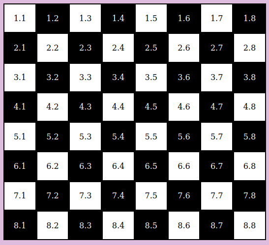

## Série 5

## Exercice 1

1.1. Créez une fonction generer_damier() qui ne prend aucun argument et qui aura pour effet de créer un damier comme suit (8x8 `div`): 

Aidez vous du fichier `.CSS` joint.

1.2. Créez et ajoutez à votre page HTML un bouton "Générer damier". Au click sur le bouton, la fonction generer_damier() doit être executée

1.3. Créez une fonction generer_tableau() sur la même base que 1.1. Mais:
- Elle prend deux arguments numériques qui seront respectivement le nombre de lignes de colonnes du tableau

(Ex: generer_tableau(2,3) créera sur la page un tableau avec 2 lignes et 3 colonnes, generer_tableau(8,8) sera similaire à generer_damier(),...)

#### *Mini-défi : Un peu plus complexe, n'hésitez pas à demander de l'aide si jamais :)*
1.4. Créez deux [inputs avec le type "number"](https://developer.mozilla.org/en-US/docs/Web/HTML/Reference/Elements/input/number) et un bouton "Générer tableau" 
- Ajoutez un event listener "click" qui lancera la fonction generer_tableau()
- Faites en sorte que le numéro entré dans le premier input "number" soit le nombre de lignes, et que le second soit le nombre de colonnes du tableau généré

Astuce : l'attribut [value](https://developer.mozilla.org/en-US/docs/Web/HTML/Reference/Elements/input/number#value) contient le nombre entré par l'utilisateur·ice